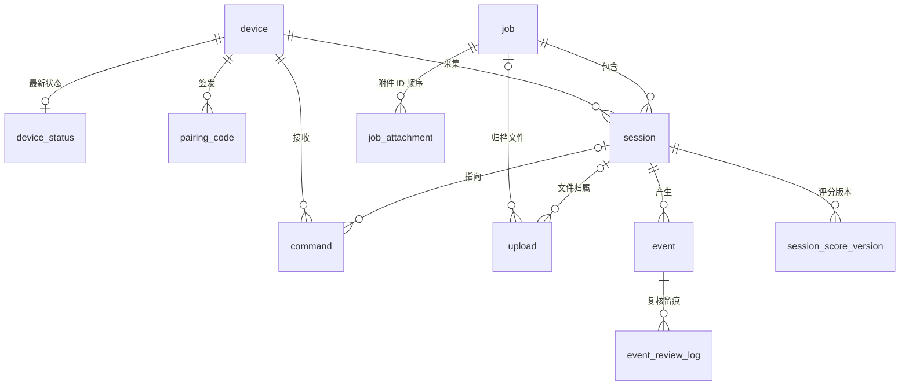

# 数据库设计与访问层说明

**依据**：T02 数据契约（`sheyuan-ui/sheyuan-ui` @ `9ea16e1`，`src/contracts/`）
**存储**：SQLite 单文件（`data/helmet-hub.db`），Node.js 内置 `node:sqlite`
**迁移**：`src/db/migrations/0001_init.sql`、`0002_upload_chunk.sql`，迁移器保证校验和与事务
**接口层**：见 [API.md](API.md)

## 1. 设计边界

契约只定义六个交换对象：`DeviceStatus`、`Job`、`Session`、`Event`、`Command`、`Upload`。
本库把这些对象原样落库，并补三张服务必需表：

| 表 | 是否契约对象 | 作用 |
| --- | --- | --- |
| `device` / `pairing_code` | 否 | 设备注册、别名、配对状态与短期配对码；`DeviceStatus` 不承载配对态 |
| `idempotency_key` | 否 | 落地 T02 硬约定“写接口必须幂等”（`Idempotency-Key`） |
| `audit_log` | 否 | 配对、远程指令、人工复核、导出留痕（设计说明 §7.8） |
| `session_score_version` / `event_review_log` | 否 | 评分版本与复核结论留痕，防止复核覆盖原始证据 |

契约未覆盖的对象（场区档案、人员、云端对象存储、视频码流参数）不建表：
`Job.location` 是创建时固化的地点快照，V1 不依赖场区主数据表。

## 2. ER 关系

## 3. 表结构

### 3.1 设备

`device`（注册表）

| 列 | 类型 | 说明 |
| --- | --- | --- |
| `device_id` | TEXT PK | 契约 `DeviceStatus.device_id` |
| `alias` | TEXT | 页面别名，契约无此字段，仅内部展示 |
| `pair_status` | TEXT | `unpaired` / `paired` / `revoked`；未配对设备仍可上报心跳 |
| `ip_address` | TEXT | 仅配对流程使用，不对外展示（T02 交接说明） |

`device_status`（每设备一行最新状态）

| 契约字段 | 列 |
| --- | --- |
| `model`、`firmware_version` | 同名 |
| `battery_pct` | 同名，`NULL` 或 0–100 |
| `wifi.connected/ssid/rssi_dbm` | `wifi_connected` / `wifi_ssid` / `wifi_rssi_dbm` |
| `hub_reachable`、`cloud_reachable` | 0/1 |
| `task_state` | 六值枚举 |
| `storage_free_bytes` | ≥ 0 |
| `last_seen` | 设备上报时刻（UTC ISO） |
| `state_version` | 乐观锁版本，较小值写入被丢弃 |

内部列 `received_at` 记录管理服务收到时刻；离线判定用 `last_seen` 与心跳阈值计算，不落库布尔值。

### 3.2 任务

`job`：标量字段同名落列；`location` 快照展开为 `location_*` + `geo_*`。
约束：`location_farm_id = farm_id`、`location_house_id = house_id`；`geo` 五个字段要么全空、要么全有。
`attachment_ids` 存 `job_attachment(job_id, file_id, position)`，读回时按 `position` 还原数组顺序。

### 3.3 会话

`session` 展开 `score` 为 `score_*` 列。`score_version` 只增不减：

- 相同版本：更新暂评值（例如运行中分数刷新）；
- 更大版本：同时写 `session_score_version`，历史保留；
- 更小版本：抛 `StaleVersionError`。

`reason` 取值 `initial` / `provisional` / `final` / `review` / `reanalysis`，用于报告追溯“分数为什么变了”。

### 3.4 事件

`event` 展开 `time`、`clip`、`review`。人工复核只更新 `review_*` 列，
`action`、`confidence`、`clip`、`evaluability` 等 AI 原始判定不被覆盖；
每次复核追加 `event_review_log`，`seq` 递增。

### 3.5 指令

`command` 展开 `result`。状态迁移只允许从 `accepted` 进入终态
（`completed` / `rejected` / `timeout` / `failed`）；重复回执返回当前值。
`expireOverdue()` 把已过 `expires_at` 的 `accepted` 改判 `timeout`，
让界面能区分“超时”与“拒绝”。

### 3.6 上传

`upload` 展开 `progress` 与 `cloud_receipt`：

- `sha256` 必须为 64 位小写十六进制；
- `uploaded_chunks <= total_chunks`、`uploaded_bytes <= size_bytes`；
- `receipt_id` 与 `receipt_verified_at` 同时有或同时无；
- `status = 'archived'` 必须有回执（无回执不得显示已归档）；
- `storage_path` 是管理服务本地文件位置，非契约字段。

`upload_chunk(file_id, chunk_index, size_bytes, received_at)` 记录已落盘的分块，
主键 `(file_id, chunk_index)`；重复分块不会重复计数。`upload.uploaded_chunks`
与 `uploaded_bytes` 每次都从该表汇总重算，重试不会把进度累加错。

文件本体保存在 `<upload_dir>/<file_id>.part`，按 `chunk_index * chunk_size` 偏移写入；
`complete` 时对整文件计算 SHA-256 与 `upload.sha256` 比对。

## 4. 通用约定

| 主题 | 约定 |
| --- | --- |
| 字段命名 | 全部 snake_case，与契约 JSON 一一对应 |
| 主键 | TEXT；设备侧 ID 原样保存，服务端对象用 UUID |
| 时间 | 契约 UTC ISO 8601；入库规范为 `YYYY-MM-DDTHH:mm:ss.sssZ`，字符串排序即时间排序 |
| 未知值 | 用 `NULL`，不用 0 或空串顶替 |
| 枚举 | TEXT + `CHECK`，契约增删枚举必须同步新迁移 |
| 派生状态 | 设备在线/离线、上传是否完成等由查询或阈值计算，不存冗余布尔 |
| 事务 | 多表写入使用 `withTransaction()`（外层 `BEGIN IMMEDIATE`，嵌套 SAVEPOINT） |
| 外键 | 每连接 `PRAGMA foreign_keys = ON`；跨库（设备文件）只存 ID |

## 5. 索引

| 索引 | 支撑查询 |
| --- | --- |
| `device_status(last_seen)` | 离线扫描、总览排序 |
| `command(device_id, issued_at)` | 单台指令历史 |
| `command(result_state, expires_at)` | 超时清理 |
| `job(farm_id, house_id, created_at)` | 按场区/栋舍看任务 |
| `session(device_id, started_at)`、`session(job_id)` | 单台会话、任务时间线 |
| `event(session_id, device_monotonic_ms)` | 事件回看按视频时间排序 |
| `event(review_conclusion)` | 待复核筛选 |
| `upload(status, created_at)` | 上传队列按状态取件 |
| `upload_chunk(file_id)` | 按文件汇总已收分块 |
| `idempotency_key(expires_at)` | 过期键清理 |
| `audit_log(target_type, target_id)` | 按对象追溯操作 |

## 6. 访问层

`createRepositories(db)` 返回八个仓储，全部返回契约对象（snake_case）：

| 仓储 | 主要方法 |
| --- | --- |
| `devices` | `register`、`setAlias`、`setPairStatus`、`upsertStatus`、`getStatus`、`listStatuses`、`issuePairCode`、`consumePairCode` |
| `jobs` | `create`、`get`、`addAttachment`、`updateStatus`、`list(filter)`、`listByDevice` |
| `sessions` | `create`、`get`、`saveScore`、`end`、`list(filter)`、`listByJob`、`listByDevice`、`listScoreVersions` |
| `events` | `insert`、`insertMany`、`get`、`listBySession`、`review`、`countByReview`、`listReviewHistory` |
| `commands` | `create`、`get`、`setResult`、`expireOverdue`、`listByDevice`、`listBySession` |
| `uploads` | `create`、`get`、`getChunkSize`、`getStoragePath`、`updateProgress`、`markUploading`、`markFailed`、`recordChunk`、`markIntegrityVerified`、`verify`、`archive`、`listByStatus`、`listByJob`、`listBySession` |
| `idempotency` | `reserve`、`complete`、`release`、`cleanupExpired` |
| `audit` | `append`、`list`、`listByTarget` |

错误类型与 HTTP 的映射（`src/server/http-errors.ts`）：

| 异常 | HTTP |
| --- | --- |
| `ValidationError` | 400 `INVALID_ARGUMENT` |
| `NotFoundError` | 404 `NOT_FOUND` |
| `ConflictError`、`StaleVersionError` | 409 `CONFLICT` |
| CHECK / 外键约束错误 | 400 `INVALID_ARGUMENT` |
| 其他 | 500 `INTERNAL`（响应不含堆栈，仅服务端日志） |

## 7. 种子与演示

`npm run seed` 使用 T02 `MOCK_CONTRACT` 写入一份演示数据，可重复执行（先清理同一批 ID）。
`npm run db` 等于迁移 + 种子。

## 8. 已知边界

- 契约未包含场区档案表；`Job.farm_name`/`house_name` 依赖创建时快照。
- 契约未包含人员与权限对象；`audit_log.actor_role` 仅保存角色字符串，认证与授权的分工见 §9。
- 分块文件本体在管理服务文件系统，库内只存 `upload_chunk` 元数据与汇总进度。
- 未做云端对象存储字段，等供应商确定后单独迁移。
- 视频码流参数、预览会话不在本层建模；预览转发待 WEB-03/06。

## 9. 认证与授权边界

本层交付到“数据已落库、访问层可读写”。认证（身份）与授权（角色与权限判定）由后续接手，不在本层实现；两边按下表分工。

| 范围 | 归属 |
| --- | --- |
| 六对象表、支撑表（幂等 / 审计 / 版本留痕）、迁移器、仓储与集成测试 | 本层 |
| 账号、角色、令牌或会话表及对应仓储 | 接手方新增迁移 |
| 登录、当前用户、登出、令牌轮换接口 | 接手方 |
| 按角色限制配对、指令下发、事件复核等写接口 | 接手方 |
| 登录失败、越权尝试、令牌吊销的审计记录 | 接手方写入 |

**本层已预留的接口点**

- `audit_log.actor_id` / `audit_log.actor_role`：列与 `viewer / operator / admin` 枚举已建；当前只有事件复核写 `actor_id`，`actor_role` 尚无写入方，接手后由认证层填。（T04 已补齐，见 §10）
- `UNAUTHORIZED`（401）/ `FORBIDDEN`（403）：错误码已在 `src/contracts/errors.ts` 定义，前端按 `code` 分支。
- 请求上下文：HTTP 已放行 `Authorization`、`X-Actor-Id` 请求头；验签后的身份可在进入路由前注入，替换当前可选的共享令牌（`HELMET_HUB_TOKEN`）。
- 审计仓储：`src/repos/audit.ts` 的 `append` / `list` / `listByTarget` 可直接记录认证事件。

**接手约定**

- 新增 `0003_auth.sql` 等迁移，只增不改；`0001` / `0002` 的校验和不能变。
- `src/contracts/` 是上游只读副本；认证对象与接口另起契约版本，不在副本上直接改。
- 当前 `X-Actor-Id` 与复核请求体里的 `reviewer_id` 均为演示占位，可被伪造，接手时须换成验签身份。

**需要先定的建模决策**

`session.operator_id`、`event.reviewer_id`、`upload.owner_id`、`job.owner_name` 目前是自由文本。认证上线后是否增加 `user` 外键或人员对照表，由本层评估并用新迁移落地；未定前保持现状，不为兼容认证提前改列。

## 10. 认证表（T04 新增，`0003_auth.sql`）

按 §9 的接手约定落地：只新增迁移，`0001` / `0002` 校验和未变；认证契约不进 `src/contracts/` 副本。

| 表 | 用途 | 关键约束 |
| --- | --- | --- |
| `app_user` | 账号、角色、状态 | `username` 唯一且 `COLLATE NOCASE`；`role ∈ (viewer, operator, admin)`；`status ∈ (active, disabled)`；`password_hash` 为 `scrypt$N$r$p$salt$hash`，参数随哈希存，便于升级 |
| `auth_refresh_token` | 刷新令牌（一次会话一条） | 只存 `token_hash`（SHA-256）；`revoked_at` 与 `revoked_reason` 必须同时有或同时无；`revoked_reason ∈ (logout, rotated, reuse_detected, disabled)`；`replaced_by` 指向轮换后的新令牌 |

访问令牌（JWT）不落库；账号停用或角色变更在下次请求时即时生效。
`auth_refresh_token.user_id` 外键指向 `app_user` 并 `ON DELETE CASCADE`，删账号即清会话。

未决：`session.operator_id` 等自由文本字段是否补外键，仍按 §9 末尾的结论保持现状，
等人员档案确定后另起迁移，不在本次改动内。
